# Nibras · نبراس

**A bilingual AI study agent that turns a list of subjects and exam dates into a day-by-day plan, then helps you keep it.**

You talk to it in Arabic or English. It works out what you want, picks one of nine tools, runs it in front of you, and updates your schedule and calendar. Every tool call is printed in the chat, with its arguments and its result, so you can see exactly what the agent did and why.

**[Open Nibras](https://afnanaljohani.github.io/Afnan/nibras/)** · no install, no sign-in, works on phone and desktop.

[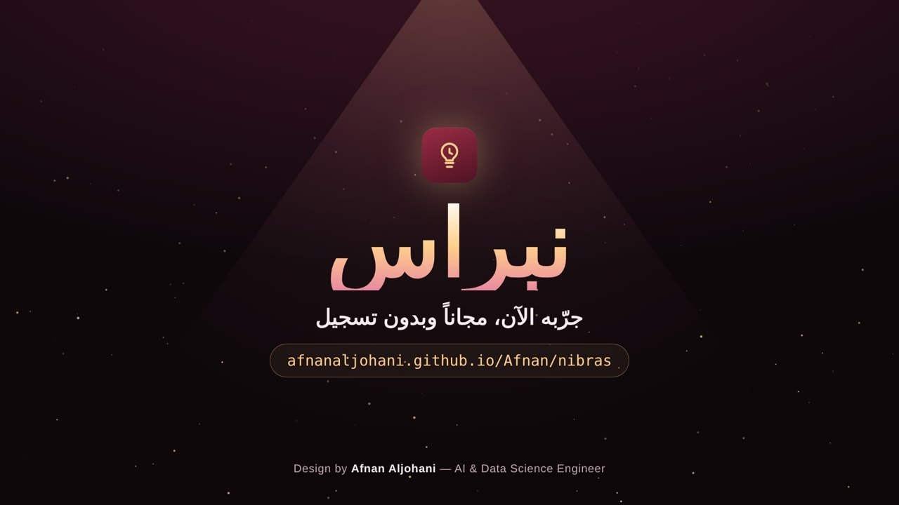](assets/nibras-teaser.mp4)

**[▶ Watch the 15-second teaser](assets/nibras-teaser.mp4)**

> **نبراس** وكيل ذكاء اصطناعي للمذاكرة، بالعربي والإنجليزي. تضيفين موادك وتواريخ اختباراتها، فيرتّب لك جدولاً يومياً، ويشغّل مؤقت التركيز، ويختبرك بأسئلة سيناريو، ويعرض كل أداة يستدعيها قدامك.

Nibras does not call a language model. Intent detection is rule-based and runs entirely in the browser, which is why it is instant, free, and private. The tools are written so that an LLM with function calling can be dropped in front of them later without changing them.

---

## What it looks like

**The landing.** The name, one sentence on what it does, and a live agent trace that replays real tool calls on a loop.

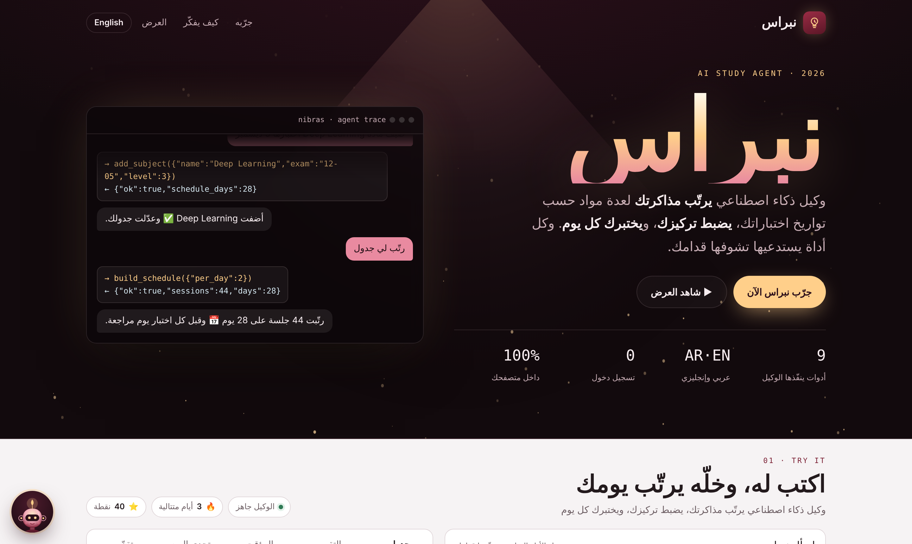

**The schedule.** Subjects on top, each with its exam date, days left, and difficulty. Below them, the plan the agent built, one row per day.

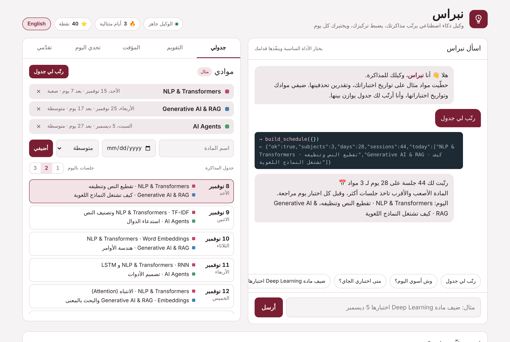

**The agent trace.** Each request becomes a tool call. The dark card shows the call (`→`) and what the tool returned (`←`); the reply underneath is written from that result, not guessed.

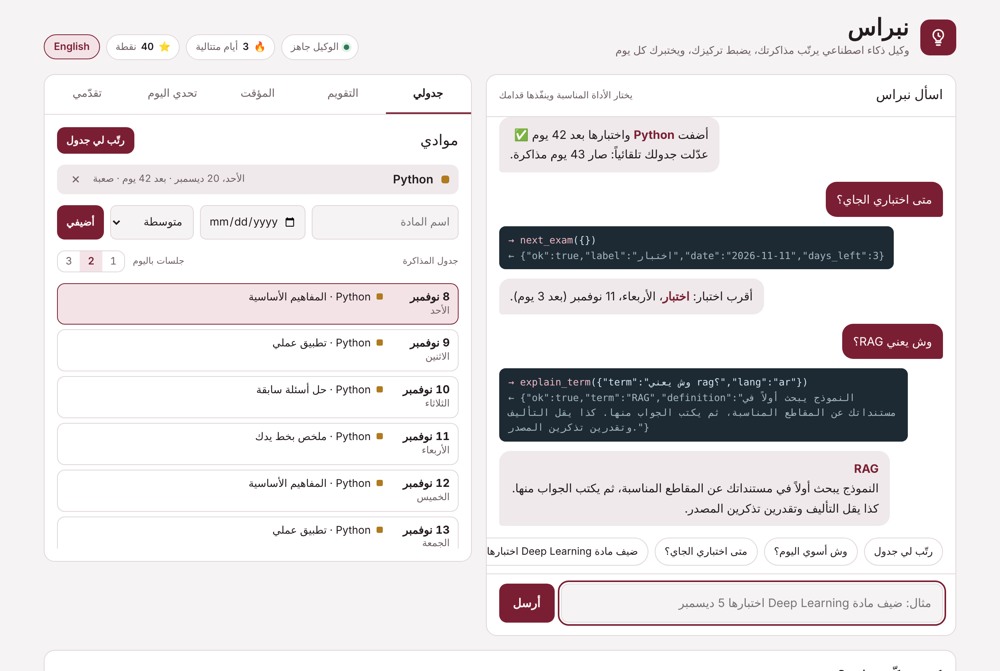

**The calendar.** January 2026 to April 2027 with Hijri months. Holidays are hatched, exam periods are shaded, your own exams are solid, and the dots on each day are the study sessions planned for it. Shown here in dark mode.

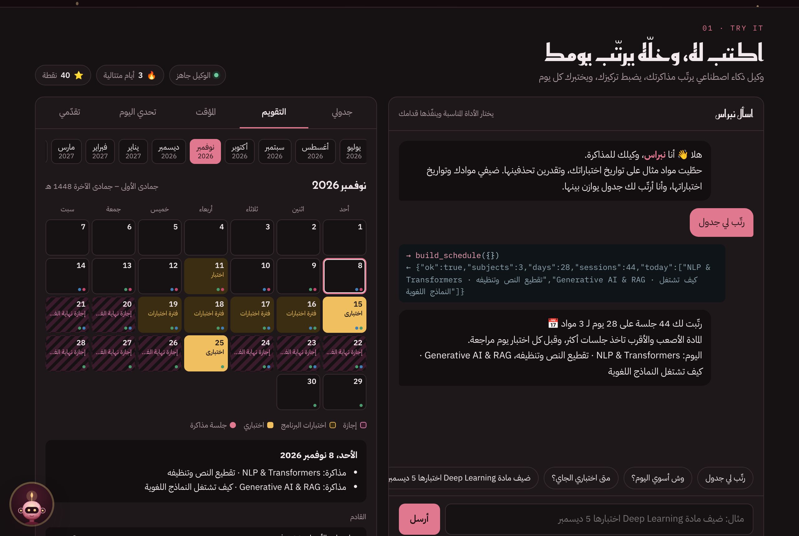

**The focus timer.** 25, 45, or 90 minutes. When a session ends, its minutes are added to today and count toward your points.

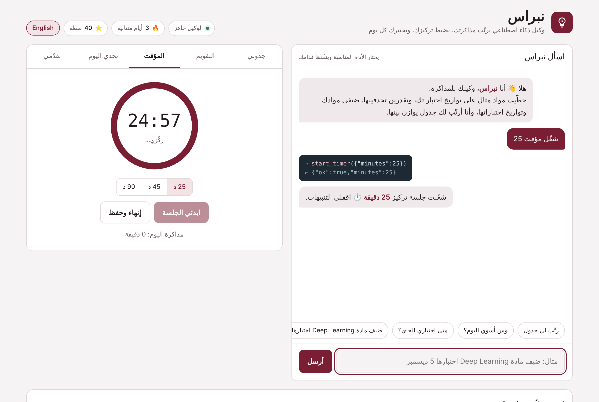

**The daily quiz.** A scenario question on applied AI with a 30-second clock. After you answer, it marks the right option and explains why.

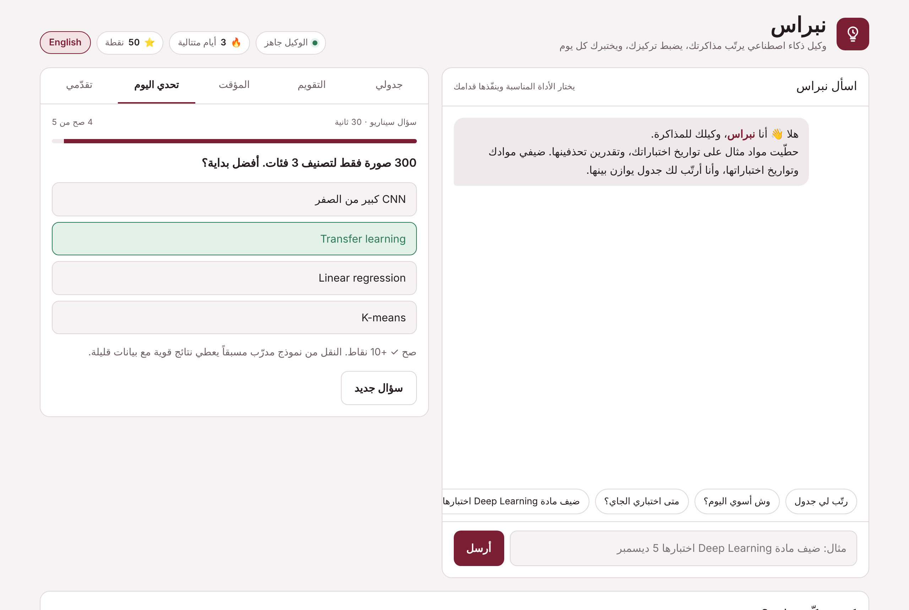

**Progress, in English.** One button switches the whole interface, direction included. The agent answers in the language of each message.

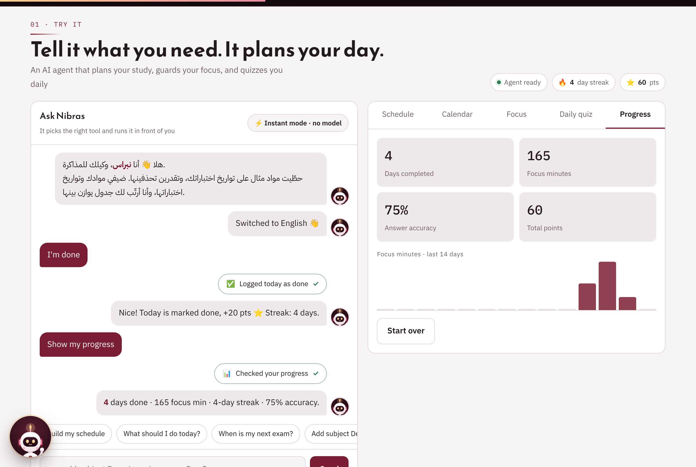

**The assistant.** A floating guide in the corner. The first tap opens a welcome card that types its own introduction; after that it opens a chat with ready questions about how Nibras works, privacy, and who built it. Anything outside its scope is handed to the main agent with one tap.

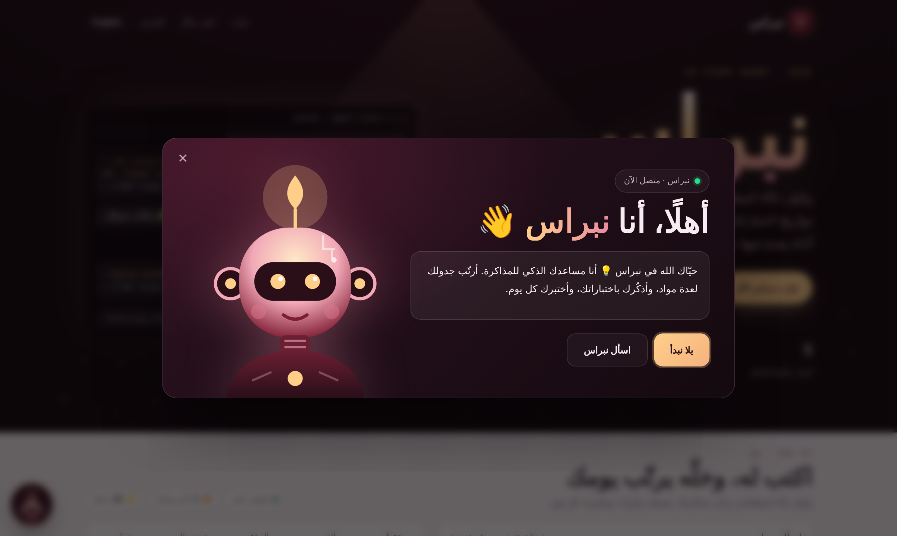

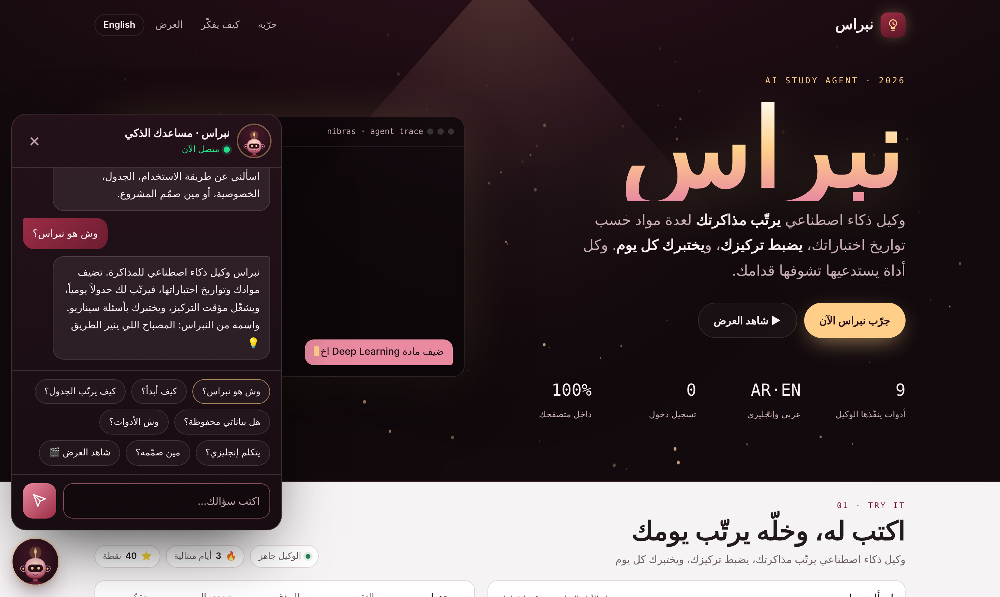

**On a phone.** The same app, stacked into one column.

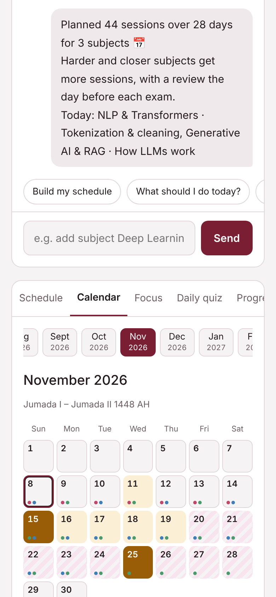

---

## How the agent works

```
message ──► understand ──► pick a tool ──► run it ──► reply
            (AR or EN)     (+ arguments)   (shown)    (from the result)
```

| You write | Tool | What happens |
|---|---|---|
| ضيف مادة Python اختبارها 20 ديسمبر صعبة | `add_subject` | Adds the subject and rebuilds the plan |
| Build my schedule | `build_schedule` | Spreads sessions over the days before each exam |
| وش أسوي اليوم؟ | `next_task` | Lists today's sessions |
| When is my next exam? | `next_exam` | Nearest exam and days left |
| شغّل مؤقت 45 | `start_timer` | Starts a focus session |
| Quiz me | `daily_challenge` | Serves a timed question |
| وش يعني RAG؟ | `explain_term` | Defines the term in your message's language |
| I'm done | `mark_done` | Marks today complete, updates the streak |
| وين وصلت؟ | `get_progress` | Days done, focus minutes, streak, accuracy |

Every command in this table was run in a headless browser, in both languages, before release.

### How the plan is built

For each day until the last exam, every subject that still has an exam ahead gets a score:

```
score = difficulty × (1 + 4 / days_until_exam) ÷ (sessions_so_far + 1)
```

The highest scores fill the day's slots (1, 2, or 3 per day, your choice). The day before an exam is always a review of that subject. Hard subjects and near exams get more time; no subject is starved, because each session already given lowers its next score.

Sessions are named after real topics when the subject is recognised (NLP, Generative AI, AI agents, deep learning, the AI engineer badge), and fall back to a general study cycle otherwise.

---

## About the data

- **Holidays and exam periods** come from a training-program timetable for 2026–2027. Exam entries are intentionally generic: the calendar says *exam* or *exam period*, never the subject or the institution.
- **Your data** (subjects, sessions, minutes, answers) is stored only in your own browser with `localStorage`. Nothing is sent anywhere.

---

## Run it locally

There is no build step and no dependency. `index.html` is the whole app.

```bash
git clone --branch gh-pages --depth 1 https://github.com/AfnanAljohani/Afnan.git
cd Afnan/nibras
python3 -m http.server 8000
# open http://localhost:8000
```

```
nibras/
├── index.html    # HTML + CSS + JavaScript, one file
├── assets/       # screenshots and the link preview
├── README.md
└── LICENSE       # MIT
```

---

## Next

- Put an LLM with function calling in front of the same nine tools
- Export the plan to Google Calendar (`.ics`)
- More quiz questions, grouped by topic
- Optional sync between devices

---

Design by **Afnan Aljohani** — AI & Data Science Engineer · [LinkedIn](https://www.linkedin.com/in/afnan-aljohani-0b5a70315/)
