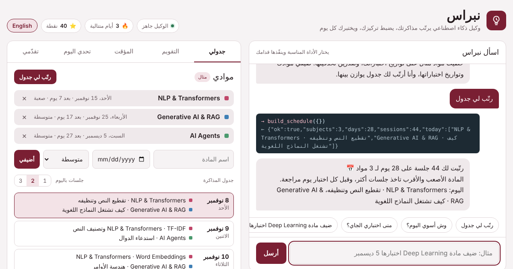

<div align="center">

# نبراس · Nibras

**وكيل ذكاء اصطناعي يرتّب مذاكرتك، يضبط تركيزك، ويختبرك كل يوم**<br>
**An AI study agent that plans your study, guards your focus, and quizzes you daily**

[**جرّبه الآن · Try it live**](https://afnanaljohani.github.io/Afnan/nibras/)



</div>

---

## العربية

### وش هو نبراس؟
نبراس وكيل ذكاء اصطناعي (AI Agent) للمذاكرة يشتغل بالكامل داخل المتصفح. تكلمينه بالعربي أو الإنجليزي، فيفهم طلبك، ويختار الأداة المناسبة، وينفّذها قدامك، ثم يحدّث جدولك وتقويمك مباشرة.

### المميزات
- **جدول ذكي لعدة مواد:** تضيفين موادك مع تواريخ اختباراتها ومستوى صعوبتها، والوكيل يوزّع الجلسات. المادة الأصعب والأقرب تاخذ جلسات أكثر، واليوم اللي قبل كل اختبار للمراجعة.
- **تقويم من يناير 2026 إلى أبريل 2027:** الإجازات، وفترات الاختبارات، واختباراتك الشخصية، وأيام المذاكرة، مع التاريخ الهجري.
- **مؤقت تركيز:** 25 أو 45 أو 90 دقيقة، والدقائق تنحفظ في يومك.
- **تحدي يومي:** أسئلة سيناريو في الذكاء الاصطناعي، مع وقت 30 ثانية ونقاط.
- **شرح المصطلحات:** RAG، Embeddings، Function Calling، Transformers، وغيرها.
- **تتبّع التقدّم:** سلسلة الأيام، دقائق التركيز، ودقة الإجابات.
- **عربي وإنجليزي** بزر واحد، مع وضع فاتح وداكن تلقائي.
- **خصوصية:** كل بياناتك محفوظة في متصفحك فقط (localStorage). ما فيه سيرفر ولا تسجيل دخول.

### جرّبي تكتبين له
| الرسالة | الأداة اللي يستدعيها |
|---|---|
| ضيف مادة Python اختبارها 20 ديسمبر صعبة | `add_subject` |
| رتّب لي جدول | `build_schedule` |
| وش أسوي اليوم؟ | `next_task` |
| متى اختباري الجاي؟ | `next_exam` |
| شغّل مؤقت 45 | `start_timer` |
| اختبرني | `daily_challenge` |
| وش يعني RAG؟ | `explain_term` |
| خلصت | `mark_done` |
| وين وصلت؟ | `get_progress` |

---

## English

### What is Nibras?
Nibras (نبراس, "the lamp that lights the way") is a browser-based AI study agent. Talk to it in Arabic or English: it detects your intent, picks a tool, runs it in front of you, and updates your schedule and calendar.

### Features
- **Multi-subject scheduler:** add subjects with exam dates and difficulty. Harder and closer subjects get more sessions, and the day before each exam is a review day.
- **Calendar (Jan 2026 – Apr 2027):** holidays, exam periods, your own exams, and study days, with Hijri months.
- **Focus timer:** 25 / 45 / 90 minutes, logged to your day.
- **Daily quiz:** 30-second AI scenario questions with points.
- **Glossary:** RAG, embeddings, function calling, transformers and more.
- **Progress:** streak, focus minutes, answer accuracy.
- **Arabic / English** toggle, automatic light and dark themes.
- **Private by design:** everything stays in your browser (localStorage). No server, no sign-in.

---

## How the agent works · كيف يفكّر الوكيل

```
User message ──► 1. Understand  (intent detection, Arabic + English)
                 2. Pick a tool (extract args: subject, date, minutes…)
                 3. Act         (run the tool, show call + result)
                 4. Reply       (answer + update schedule / calendar)
```

Every tool call is shown in the chat as a card, exactly like LLM function calling:

```
→ add_subject({"name":"Python","exam":"2026-12-20","level":3})
← {"ok":true,"subject":"Python","days_left":42,"schedule_days":43}
```

| Tool | What it does |
|---|---|
| `add_subject` | Adds a subject with exam date and level, then rebuilds the schedule |
| `build_schedule` | Spreads sessions across days by difficulty and exam proximity |
| `next_task` | Today's sessions |
| `next_exam` | The nearest exam and days left |
| `start_timer` | Starts a focus session |
| `daily_challenge` | Serves a timed scenario question |
| `explain_term` | Defines an AI term in the message's language |
| `mark_done` | Marks today complete and updates the streak |
| `get_progress` | Days done, focus minutes, streak, accuracy |

### Scheduling logic
For each day until the last exam, every open subject gets a score:

```
score = level × (1 + 4 / days_until_exam) ÷ (sessions_so_far + 1)
```

The top-scoring subjects fill the day's slots (1–3 per day). The day before an exam is reserved for reviewing that subject.

---

## Run it · التشغيل

No build step and no dependencies. Open the live page, or download the `nibras` folder and open `index.html`, or serve it:

```bash
git clone --branch gh-pages --depth 1 https://github.com/AfnanAljohani/Afnan.git
cd Afnan/nibras
python3 -m http.server 8000
# open http://localhost:8000
```

## Project structure

```
nibras/
├── index.html      # the whole app: HTML + CSS + JS, no dependencies
├── assets/         # screenshots and link preview
├── README.md
└── LICENSE
```

## Screenshots

| Schedule (Arabic) | Calendar (dark) | Mobile (English) |
|---|---|---|
|  |  |  |

## Roadmap · الخطوات القادمة
- [ ] Connect an LLM (Gemini) for free-form understanding, keeping the same tools
- [ ] Export the schedule to Google Calendar (.ics)
- [ ] Add more quiz questions and topics
- [ ] Optional sync across devices

## Tech
Vanilla HTML, CSS and JavaScript · `Intl` for Gregorian and Umm al-Qura dates · Google Fonts (Reem Kufi, IBM Plex Sans Arabic, IBM Plex Mono).

---

<div align="center">

Design by **Afnan Aljohani** — AI & Data Science Engineer<br>
[LinkedIn](https://www.linkedin.com/in/afnan-aljohani-0b5a70315/)

</div>
